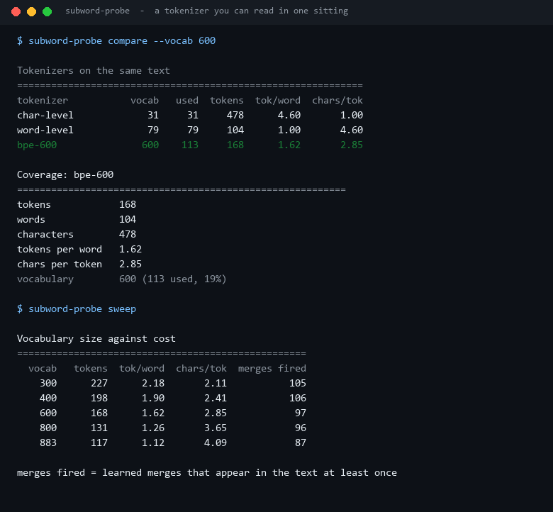
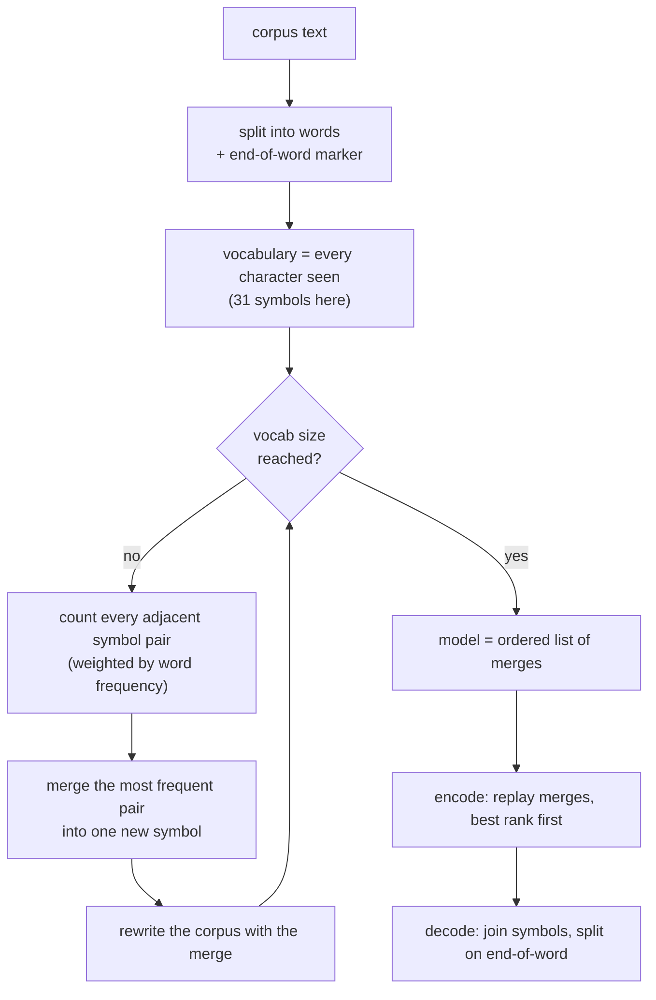
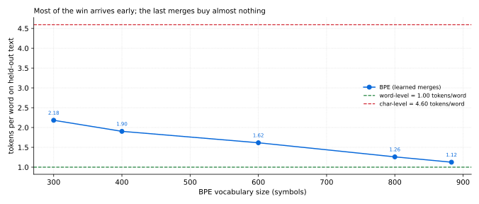
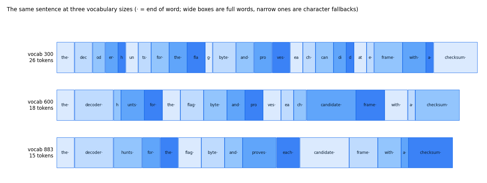

# Subword-Coverage-Probe

**Trains a byte-pair tokenizer from scratch, then answers the only question that matters when you
choose a vocabulary size: how many tokens does a word actually cost, and how much of the vocabulary
earns its place?**

No `tokenizers` wheel, no `sentencepiece`, no downloaded model. Three hundred lines of standard
library Python, so every number is inspectable.



Every figure comes from `scripts/render_assets.py` running this repository's code on
`examples/corpus.txt` and `examples/heldout.txt`.

---

## Table of contents

- [Why this exists](#why-this-exists)
- [What BPE actually does](#what-bpe-actually-does)
- [The three tokenizers, measured](#the-three-tokenizers-measured)
- [Vocabulary size against cost](#vocabulary-size-against-cost)
- [Watching the segmentation change](#watching-the-segmentation-change)
- [Install and run](#install-and-run)
- [Commands](#commands)
- [Corpus format](#corpus-format)
- [Design notes and limits](#design-notes-and-limits)
- [Tests](#tests)
- [License](#license)

---

## Why this exists

"Use a 32k vocabulary" is repeated so often that it sounds like a law of nature. It is a
trade-off, and the trade has three sides that can all be measured on your own text:

1. **Tokens per word** - the number your context window and your bill are made of.
2. **Vocabulary size** - the number of embedding rows you pay for, and train.
3. **Utilisation** - how much of that vocabulary actually fires. A vocabulary that is 19% used is
   mostly dead weight.

The tool builds the tokenizer, so the answer is not a benchmark someone else ran on someone else's
corpus.

## What BPE actually does



The end-of-word marker is why `the` and `theme` learn different merges: `the·` and `th` + `e` + `m`
+ `e` are different pair sequences, so word boundaries survive tokenisation. Encoding replays the
merges in the order they were learned (the classic greedy longest-match), and decoding is a plain
string join, which makes the round trip exact.

## The three tokenizers, measured

On 104 held-out words (478 characters) that were not in the training corpus:

| Tokenizer | Vocabulary | Used | Tokens | Tokens/word | Chars/token |
| --- | ---: | ---: | ---: | ---: | ---: |
| character-level | 31 | 31 | 478 | **4.60** | 1.00 |
| word-level | 79 | 79 | 104 | **1.00** | 4.60 |
| BPE, 600 symbols | 600 | 113 (19%) | 168 | **1.62** | 2.85 |

The word-level row is the trap. It looks perfect - one token per word - because the held-out text
happens to use only 79 distinct words. On real text the word vocabulary explodes, and any word
outside it has no representation at all. BPE gives up 62% more tokens than the impossible
word-level ideal and in exchange has no unknown-word failure mode.

Byte-pair encoding is **lossless for unseen characters** too: a character missing from the training
alphabet passes through as a single symbol rather than being dropped or mapped to `[UNK]`. That is
a property the tests pin down, not a claim.

## Vocabulary size against cost



| Vocabulary | Tokens on held-out text | Tokens/word | Chars/token | Merges that fired |
| ---: | ---: | ---: | ---: | ---: |
| 300 | 227 | 2.18 | 2.11 | 105 |
| 400 | 198 | 1.90 | 2.41 | 106 |
| 600 | 168 | 1.62 | 2.85 | 97 |
| 800 | 131 | 1.26 | 3.65 | 96 |
| 883 | 117 | 1.12 | 4.09 | 87 |

Two things fall out of that table:

- **The curve flattens.** Going 300 → 600 symbols removes 59 tokens; going 600 → 883 removes 51
  more while adding 283 symbols. On a 3.1 KB corpus, there is nothing left to merge: the run stops
  at **883 symbols** and the tool says so instead of pretending a 2400-symbol vocabulary exists.
- **Later merges fire less.** The number of learned merges that appear in the held-out text *falls*
  from 106 to 87 as the vocabulary grows, because the extra merges were learned from corpus-specific
  fragments that never show up again. That is vocabulary paid for and not used - visible only
  because utilisation is measured rather than assumed.

## Watching the segmentation change



The same sentence, three vocabularies:

- at **300**, `decoder` is `dec | od | er` and `candidate` is `can | di | d | at | e`;
- at **600**, `decoder` is one token but `hunts` is still `h | unts`;
- at **883**, `hunts`, `proves` and `each` collapse, and the sentence costs 15 tokens for 14 words.

This is the picture that argues for corpus-matched tokenizers: the fragments a tokenizer learns are
whatever your text repeats, and nothing else.

## Install and run

Standard library only.

```bash
python -m pip install -e ".[dev]"
subword-probe compare --vocab 600
```

From a checkout without installing:

```bash
PYTHONPATH=src python -m subword_coverage_probe compare --vocab 600
```

## Commands

| Command | What it does |
| --- | --- |
| `train --corpus F --vocab N` | learn merges and print the first ones |
| `encode --text "..."` | tokenize a string and show the round trip |
| `compare --heldout F [--format json]` | char vs word vs BPE on held-out text |
| `sweep --vocabs 300,600,883` | cost against vocabulary size |
| `common --limit 8` | most frequent tokens in the corpus |

## Corpus format

Plain UTF-8 text, whitespace-tokenised. `examples/corpus.txt` is ~3.1 KB of prose written for this
repository (about framing, deduplication and tokenization), and `examples/heldout.txt` is a
2-paragraph sample that is deliberately similar in subject so the comparison is fair. Both are
original text in this repository - nothing is copied from elsewhere.

Point `--corpus` at your own domain text before trusting any number: a tokenizer trained on
protocol documentation will fragment marketing copy, and that is the whole point of measuring.

## Design notes and limits

- **Merges are learned on the training corpus, and the vocabulary is exactly `base + merges`.** No
  `[UNK]`, no special tokens beyond the end-of-word marker, so token IDs are indices into
  `model.vocab`.
- **Ties break on the pair itself**, so training is deterministic: two runs on the same corpus give
  byte-identical merges. Without that, the committed charts would not be reproducible.
- **Encoding is greedy by merge rank**, which is the standard BPE approach but not necessarily the
  tokenisation with the fewest tokens; optimal segmentation needs dynamic programming.
- **Character-level base.** A byte-level base (as GPT-style tokenizers use) would shrink the base
  vocabulary and make unseen Unicode cheap. This implementation is character-based because it keeps
  the merges human-readable, which is the point of the project.
- **A small corpus saturates.** 3.1 KB of text can only produce 883 symbols; bigger vocabularies
  need more text, and `sweep` says so rather than silently repeating the last row.
- **No speed claims.** This is an inspectable reference implementation, not a fast one.

## Tests

```bash
PYTHONPATH=src python -m pytest -q     # 35 passed
python -m ruff check .                 # All checks passed!
```

35 tests cover end-of-word handling, frequency counting, the first merge being the most frequent
pair, vocabulary growth, exact round trips (including unseen characters), character fallback for
unknown words, coverage metrics, utilisation, OOV accounting, every report, and every CLI command
including the saturation note.

## License

MIT. See [LICENSE](LICENSE).

---

<sub>Screenshots and charts are generated by `scripts/render_assets.py` from this repository's own
corpus. No third-party text or images are used.</sub>
